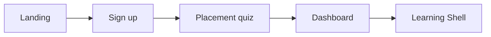

# Wireframe Map — Template → Product Screen

Assemble the unified platform by **composing frames** from duplicated kits.  
No net-new wireframing until custom zones (Deploy panel, Beat rail) are marked below.

---

## Flow 1: Acquisition → first lesson



| Step | Product screen | Copy frame from | Modify |
|------|----------------|-----------------|--------|
| 1 | Landing | LearnPro hero **or** SkillQue landing **or** E-Tutor home | Headline: “Math for AI”; CTA: “Start free”; embed 2-min demo |
| 2 | Sign up / Login | E-Tutor authentication pages | Social + email; remove teacher signup |
| 3 | Placement quiz | E-Tutor quiz **or** LMS Template 2 assessment | 10 questions; `/find-your-level` copy |
| 4 | Dashboard | SkillQue student dashboard **or** Learning Skills Platform dashboard | Replace courses with **Phases 0–19**; show next lesson |
| 5 | Learning Shell | Code Editor Learning Platform main frame | Add narrative column + output column (see below) |

---

## Flow 2: Learning Shell (custom compose)

**Base:** [Code Editor Learning Platform UI](https://www.figma.com/design/ombLNHqde0OB66uIesz7Ay/Code-Editor-Learning-Platform-UI--Community-)

```
┌─────────────────────────────────────────────────────────────────┐
│ FROM: E-Tutor header OR kit header — add step dots, streak      │
├──────────────┬──────────────────────────────┬─────────────────────┤
│ NEW COLUMN   │ FROM: Code Editor kit        │ NEW COLUMN          │
│ 240px        │ center editor + file tree    │ 320px               │
│              │                              │                     │
│ Narrative:   │ Workspace:                   │ Output:             │
│ - E-Tutor    │ - Monaco area from kit       │ - Terminal output   │
│   lesson text│ - OR CS Lab editor style     │ - Test results      │
│ - Coursiva   │ - Figure embed zone          │ - Plot preview      │
│   step cards │   (placeholder rectangle)    │ - Deploy URL card   │
├──────────────┴──────────────────────────────┴─────────────────────┤
│ NEW: action bar — Run | Deploy | Continue                       │
└─────────────────────────────────────────────────────────────────┘
```

| Zone | Template source | Custom wireframe |
|------|-----------------|------------------|
| Header | E-Tutor course player header | Add: `Phase 1 · L04 · BUILD · 3/7` |
| Narrative | Coursiva step cards + E-Tutor lesson content | Beat label, scroll independent |
| Figure | Rectangle + label “interactive figure” | Port `vector-projection` later |
| Editor | Code Editor kit | Pre-filled starter code state |
| File tree | Code Editor kit | Collapsible |
| Output | CS Lab Editor output panel | Pass/fail badge |
| **Deploy panel** | **NEW** — use SaaSPro “status card” | URL, Postgres status, logs link |
| Quiz overlay | E-Tutor quiz modal | Pre/post badge |
| Tutor drawer | Boot.dev-style chat (reference screenshot) | Slide from right |

---

## Flow 3: Lesson step types (Coursiv-style cards)

Duplicate **Coursiva.io** mobile step frames for narrative column variants:

| Step type | Frame | Gate UI |
|-----------|-------|---------|
| MOTTO | Full-bleed card, one line | Continue |
| CONCEPT | Text + figure placeholder | “Got it” |
| PRE-QUIZ | E-Tutor quiz 2-option | Correct → continue |
| CODE | Shell default | Run + tests |
| SHIP | Card + download CTA | “Added to toolkit” toast |
| POST-QUIZ | E-Tutor quiz | ≥80% → lesson complete |

---

## Flow 4: Dashboard & progress

| Screen | Primary template | Elements |
|--------|------------------|----------|
| Path overview | Learning Skills Platform — Courses Overview | Phase cards with progress bars |
| Phase detail | E-Tutor course curriculum page | Lesson list, lock icons |
| Achievements | Learning Skills Platform — User Achievements | XP, streak, certificates |
| Portfolio | E-Tutor **or** LMS Dashboards analytics | Grid of **live deploy URLs** |
| Toolkit | E-Tutor wishlist / library pattern | 503 artifacts list |

---

## Flow 5: Marketing & launch

| Page | Template |
|------|----------|
| Pricing | LearnPro pricing **or** SaaSPro blocks |
| About / philosophy | SkillQue feature section |
| Blog | E-Tutor blog template |
| Waitlist | LearnPro CTA section (email capture) |

---

## Flow 6: Capstone (Phase 19)

| Screen | Template | Custom |
|--------|----------|--------|
| Capstone intro | E-Tutor course detail | Rubric table, stack diagram |
| Build mode | Learning Shell (T2) | Deploy enabled |
| Rubric results | LMS Dashboards analytics | RAGAS scores, cost report |
| SaaS gallery | Portfolio grid | “Fork template” CTA |

---

## Figma pages to create (ordered)

1. **Cover + tokens** — color/text styles only  
2. **Shell — Concept step** — narrative heavy  
3. **Shell — Code step** — editor heavy  
4. **Shell — Deploy step** — deploy panel visible  
5. **Dashboard** — composed  
6. **Landing** — composed  
7. **Flow prototype** — link 1→5 with Figma prototype  

**Time estimate:** 4–6 hours with templates vs 2–3 days from blank.

---

## Reference screenshots (pin in Figma)

Save to `99 — Reference` page:

- Scrimba: paused scrim with editable code
- Boot.dev: lesson + Boots chat
- Coursiv: mobile step progression
- aiengineeringfromscratch.com: blueprint aesthetic
